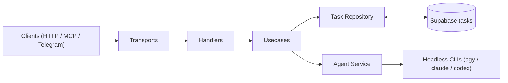

# System Architecture

`task-aside` is a single-process, zero-dependency Node/Bun service pairing HTTP/MCP/STDIO/Telegram transports with a sequential background worker backed by Supabase and headless CLI agents (`agy`, `claude`, `codex`).

## Component Overview

## Layer & Storage Boundaries

| Area | Responsibility | Constraints |
| --- | --- | --- |
| `transports/` | HTTP, Streamable/STDIO MCP, Telegram polling, adaptive worker | Calls `handlers/` only; no direct DB or CLI access |
| `handlers/` | Validation, capabilities view, event forwarding, typed errors | Transport-agnostic; calls `usecases/` only |
| `usecases/` | Orchestration, idempotency, subtask caps, cancel/retry, lease heartbeat | Calls `services/` and `repositories/` only |
| `services/` | Policy checks, opt-in git worktree, prompt rendering, CLI dispatch, redaction | No shell interpolation; scrubs secrets before disk writes |
| `repositories/` | Supabase PostgREST + RPC queries and in-memory test adapter | Async boundary; single source of queue & result state |
| `~/.task-aside/` | Global `settings.json`, daily redacted `logs/`, per-run `runs/` | Auto-created at startup; replaces project `.env` files |
| `public.tasks` | Distributed queue, state, `idempotency_key`, and `v1` envelopes | Atomic `claim_next_task`, attempt-fenced `extend_task_lease`, `get_task_stats` |

## Core Contracts & Modes

- **Envelopes (`v1`)**: Input envelopes carry OTel metadata, priority, optional `parent_id`, and client `execution` settings (including opt-in `worktree`); result envelopes mirror trace context plus `status`, redacted Markdown `output`, `usage`, `artifacts`, and `error`.
- **CLI Modes**: Default daemon runs configured transports; `task-aside mcp` starts intake-only STDIO MCP; `task-aside doctor` checks config, Supabase RPCs, and CLIs; `task-aside auth telegram` pairs a single-owner DM.
- **Guardrails**: Global `allowed_workspaces` restricts `cwd`; worker policies enforce `allowed_agents`, permission ceilings, `default_timeout_ms`, `poll_max_interval_ms`, `max_subtask_depth`, and `max_subtasks_per_root`.

## Sequence Flows

| Document | Scope |
| --- | --- |
| [seq-task-intake.md](./seq-task-intake.md) | Creating, fetching, listing, cancelling, retrying, and inspecting capabilities |
| [seq-telegram.md](./seq-telegram.md) | One-time pairing, Draft Cards, commands, callbacks, Swipe-Reply, and delivery |
| [seq-worker-execution.md](./seq-worker-execution.md) | Adaptive polling, atomic claim, fenced heartbeat, worktree isolation, and redaction |
| [seq-recovery-and-hitl.md](./seq-recovery-and-hitl.md) | State machine, cancel/retry, lease expiry, shutdown, subtask limits, and HITL resume |
