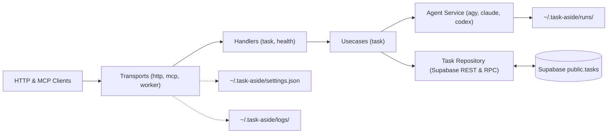

# System Architecture

`task-aside` is a single-process, zero-dependency Node/Bun service combining an HTTP/MCP server and a sequential background worker backed by Supabase Postgres/PostgREST and headless CLI agents (`agy`, `claude`, `codex`).

## Component Overview

## Layer & Storage Boundaries

| Area | Responsibility | Constraints |
| --- | --- | --- |
| `transports/` | HTTP routes, JSON-RPC MCP, sequential worker polling | Calls `handlers/` only; never touches DB or agent CLIs |
| `handlers/` | Input validation and typed error mapping | Transport-agnostic; calls `usecases/` only |
| `usecases/` | Task orchestration, lease heartbeat, result persistence | Calls `services/` and `repositories/` only |
| `services/` | Policy checks, prompt rendering, headless CLI dispatch, artifact capture | No shell interpolation; writes run artifacts locally |
| `repositories/` | Supabase PostgREST + RPC queries and in-memory test adapter | Async boundary; single source of queue & result state |
| `~/.task-aside/` | Global `settings.json`, daily `logs/`, per-run `runs/` | Auto-created on startup; replaces project `.env` files |
| `public.tasks` | Distributed queue, state, `input_envelope`, and `result_envelope` | Atomic claim via `claim_next_task`; lease via `extend_task_lease` |

## Core Contracts

- **Input Envelope (`v1`)**: Carries `schema`, OTel `metadata` (`trace_id`, `span_id`, timestamps), and `data` (`id`, `title`, `description`, `parent_id`, `priority`, and client-selected `execution` config).
- **Result Envelope (`v1` / `task_result`)**: Mirrors the input envelope shape with propagated `trace_id` and `parent_span_id`, plus `status`, effective `execution` details, Markdown `output`, token/cost `usage`, local `artifacts` paths, and structured `error`.
- **Worker Policies**: Enforced per worker via `allowed_agents`, `default_permission_mode`, `max_permission_mode`, `allowed_cwd_roots`, and `default_timeout_ms`.

## Sequence Flows

| Document | Scope |
| --- | --- |
| [seq-task-intake.md](./seq-task-intake.md) | Creating, fetching, and listing tasks over HTTP and MCP |
| [seq-worker-execution.md](./seq-worker-execution.md) | Polling, atomic claim, heartbeat, headless CLI execution, and artifact storage |
| [seq-recovery-and-hitl.md](./seq-recovery-and-hitl.md) | State machine, failures, lease expiry, shutdown, subtask breakdown, and resume |
