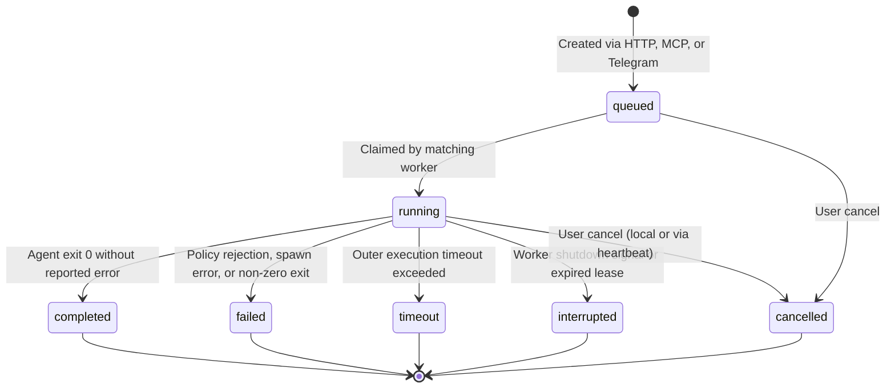
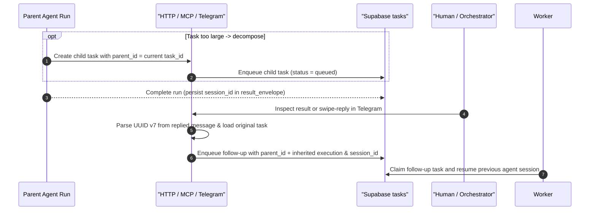

# Sequence: Recovery, Breakdown & HITL

Covers task terminal states, failure, cancellation, retry, lease-expiry handling, graceful shutdown, subtask decomposition via `parent_id`, and session continuation via `session_id` or Telegram Reply-to-Resume.

## Task State Machine

## Subtask Breakdown & HITL Resume

## Failure, Cancel & Recovery Semantics

| Scenario | Final Status | Replay Policy & Notes |
| --- | --- | --- |
| **Pre-spawn policy failure** | `failed` | Writes `result.json` with `permission` or `validation` error; no automatic retry |
| **CLI non-zero / spawn error** | `failed` | Never auto-replayed after spawn; human-triggered `retry` creates a new linked task |
| **Outer timeout exceeded** | `timeout` | Sends `SIGTERM` (5s `SIGKILL` fallback) and persists `EXECUTION_TIMEOUT` |
| **Graceful shutdown (`SIGINT`/`SIGTERM`)** | `interrupted` | Aborts child process and persists `interrupted` without aborting DB write |
| **Worker crash (lease expired)** | `interrupted` | Next `claim_next_task` call transitions stale `running` rows to `interrupted` (`LEASE_EXPIRED`) |
| **Human cancellation / Retry** | `cancelled` | `cancel` aborts active run and locks status; `retry` creates a fresh child row via `parent_id` |
