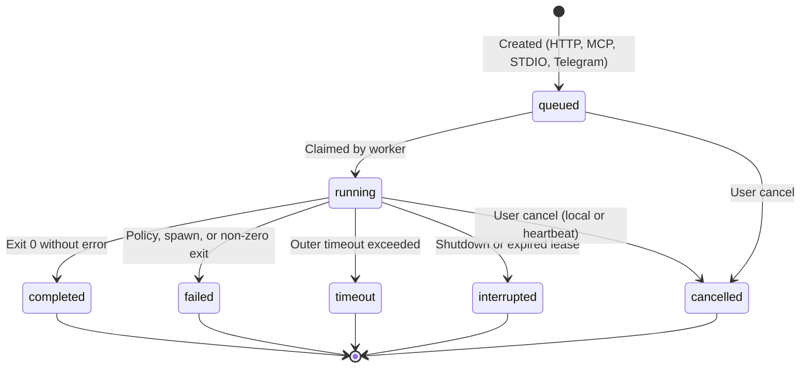
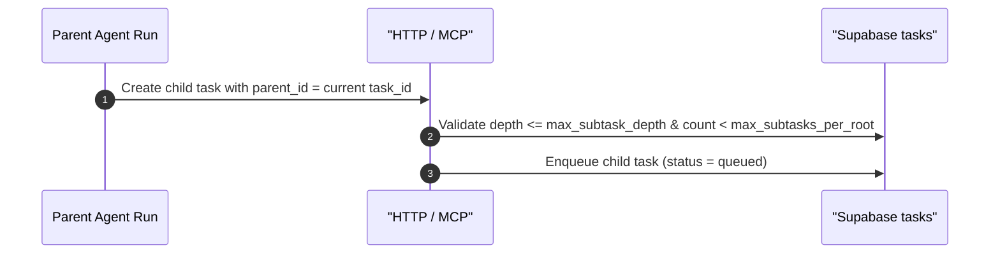
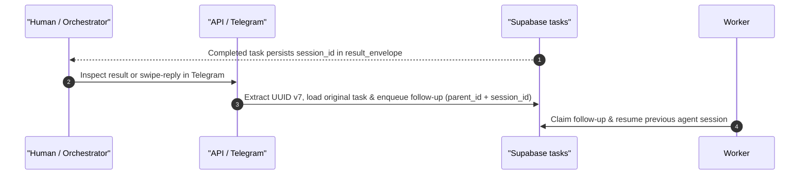

# Sequence: Recovery, Breakdown & HITL

Covers task terminal states, failure, cancellation, retry, attempt fencing, lease-expiry handling, graceful shutdown, subtask guardrails, and session continuation via `session_id` or Telegram Swipe-Reply.

## 1. Task State Machine

## 2. Agent Subtask Breakdown

## 3. HITL Session Resume

## Failure, Cancel & Recovery Semantics

| Scenario | Final Status | Replay Policy & Notes |
| --- | --- | --- |
| **Pre-spawn policy / worktree failure** | `failed` | Writes redacted `result.json` with `permission`, `validation`, or `environment` error; no auto-retry |
| **CLI non-zero / spawn error** | `failed` | Never auto-replayed after spawn; human-triggered `retry` creates a new linked task |
| **Outer timeout exceeded** | `timeout` | Sends `SIGTERM` (5s `SIGKILL` fallback) and persists `EXECUTION_TIMEOUT` |
| **Graceful shutdown (`SIGINT`/`SIGTERM`)** | `interrupted` | Aborts child process and persists `interrupted` without aborting DB write |
| **Worker crash / stale attempt** | `interrupted` | `claim_next_task` expires stale leases; `attempts` fencing stops stale workers overwriting newer runs |
| **Subtask limits & Retry** | `queued` / `cancelled` | `createTask` enforces `max_subtask_depth` and `max_subtasks_per_root`; `retryTask` is exempt so retries never fail on depth |
