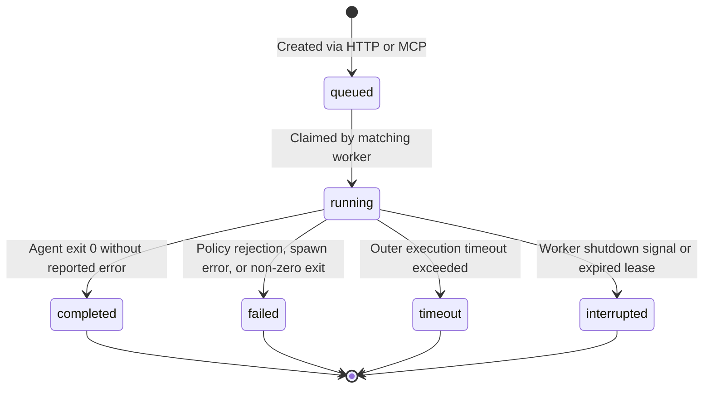
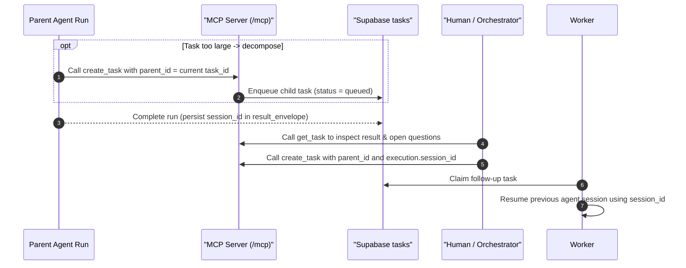

# Sequence: Recovery, Breakdown & HITL

Covers task terminal states, failure and lease-expiry handling, graceful shutdown, subtask decomposition via `parent_id`, and session continuation via `session_id`.

## Task State Machine

## Subtask Breakdown & HITL Resume

## Failure & Recovery Semantics

| Scenario | Final Status | Replay Policy & Notes |
| --- | --- | --- |
| **Pre-spawn policy failure** | `failed` | Writes `result.json` with error category `permission` or `validation`; no retry |
| **CLI non-zero / spawn error** | `failed` | Never blindly replayed after spawn to protect workspace from partial edits |
| **Outer timeout exceeded** | `timeout` | Sends `SIGTERM` (5s `SIGKILL` fallback) and persists `EXECUTION_TIMEOUT` |
| **Graceful shutdown (`SIGINT`/`SIGTERM`)** | `interrupted` | Aborts child process and persists `interrupted` without forwarding abort signal to DB write |
| **Worker crash (lease expired)** | `interrupted` | Next `claim_next_task` call transitions stale `running` rows to `interrupted` (`LEASE_EXPIRED`) |
