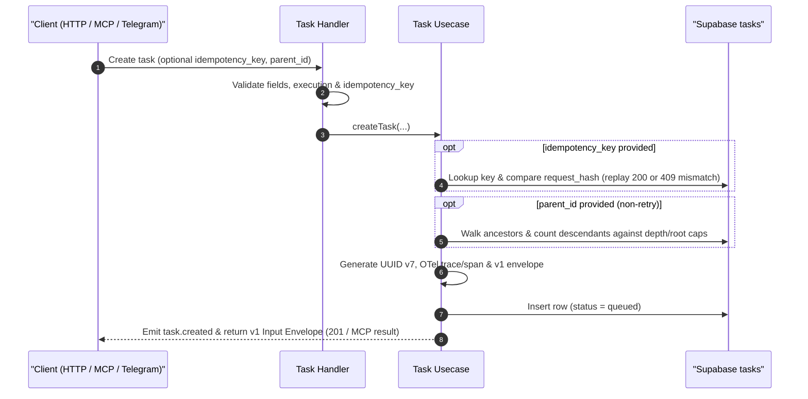
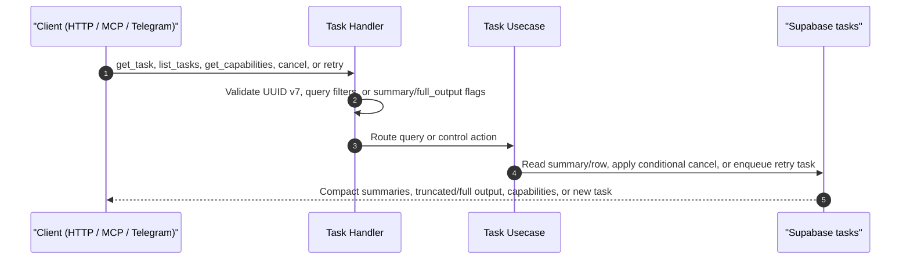

# Sequence: Task Intake, Queries & Control

Covers creating tasks (`POST /tasks`, HTTP/STDIO MCP `create_task`, Telegram Draft Card or `/run`), inspecting capabilities (`get_capabilities`), reading/listing tasks, cancelling, and retrying.

## 1. Create Task Flow

## 2. Query & Control Flow

## Intake & Control Rules

| Rule | Behavior |
| --- | --- |
| **Client-owned fields** | Client chooses `priority` (`P0`–`P3`), `execution.agent`, and optional `model`, `effort`, `cwd`, `permission_mode`, `timeout_ms`, `session_id`, `worktree` |
| **Idempotency** | `idempotency_key` (body or `Idempotency-Key` header) hashes normalized inputs; exact match replays (`200` / `idempotent_replay`), mismatch returns `409` |
| **MCP context defense** | `list_tasks` returns compact summaries; `get_task` truncates `output.text` at 6000 chars (unless `full_output: true`), adds `poll_after_ms`, and flags `untrusted_output: true` |
| **STDIO MCP mode** | `task-aside mcp` serves intake/query tools over stdin/stdout (logs to files only); background worker runs separately |
| **Telegram intake** | Paired single-owner DM (`user_id` + `chat_id`) opens a Draft Card or enqueues via `/run`; unauthorized updates are ignored |
| **Subtask & error mapping** | Non-retry `parent_id` enforces existence, depth, and per-root caps (`400`); invalid input `400`/`-32602`, missing `404`, conflict `409`, DB error `502` |
