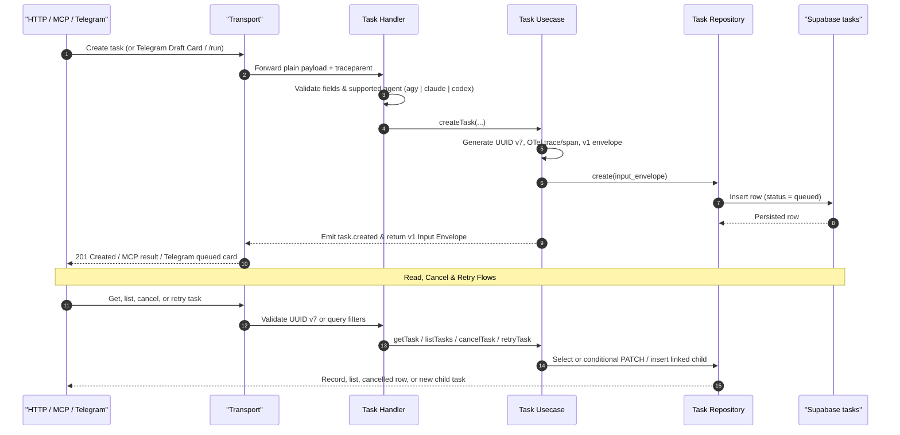

# Sequence: Task Intake, Queries & Control

Covers creating tasks (`POST /tasks`, MCP `create_task`, Telegram Draft Card or `/run`), inspecting/listing tasks, cancelling (`POST /tasks/:id/cancel`, MCP `cancel_task`, `/cancel`), and retrying (`POST /tasks/:id/retry`, MCP `retry_task`, `/retry`).

## Intake & Control Flow

## Intake & Control Rules

| Rule | Behavior |
| --- | --- |
| **Client-owned fields** | Client chooses `priority` (`P0`–`P3`), `execution.agent`, and optional `model`, `effort`, `cwd`, `permission_mode`, `timeout_ms`, `session_id` |
| **Telegram intake** | Paired single-owner DM (`user_id` + `chat_id`) opens a 1-tap Draft Card or enqueues via `/run`; unauthorized users/chats are ignored |
| **Server-generated fields** | Service generates `data.id` (UUID v7), UTC timestamps, and `trace_id`/`span_id` (propagating `traceparent` if present) |
| **Cancel & retry semantics** | `cancelTask` transitions `queued` or `running` to `cancelled`; `retryTask` enqueues a new task with `parent_id` from any terminal status |
| **Error mapping** | Invalid input returns `400`/`-32602`; missing ID returns `404`/tool error; invalid state transition returns `409`/tool error; DB failure returns `502` |
