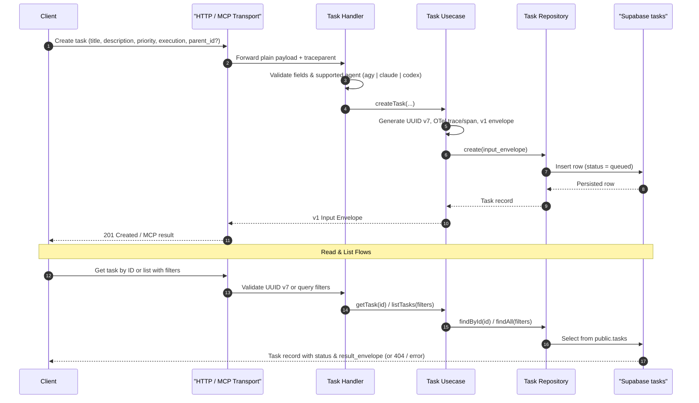

# Sequence: Task Intake & Queries

Covers creating tasks (`POST /tasks`, MCP `create_task`), inspecting a task (`GET /tasks/:id`, MCP `get_task`), and listing tasks (`GET /tasks`, MCP `list_tasks`).

## Intake & Query Flow

## Intake Rules

| Rule | Behavior |
| --- | --- |
| **Client-owned fields** | Client chooses `priority` (`P0`–`P3`), `execution.agent`, and optional `model`, `effort`, `cwd`, `permission_mode`, `timeout_ms`, `session_id` |
| **Server-generated fields** | Service always generates `data.id` (UUID v7), UTC timestamps, and `trace_id`/`span_id` (propagating `traceparent` if present) |
| **Allowlist boundary** | HTTP/MCP validates that `execution.agent` is a supported harness; worker-specific `allowed_agents` is enforced at claim time |
| **Error mapping** | Invalid input returns HTTP `400` / JSON-RPC `-32602`; missing ID returns `404` / MCP tool error; Supabase failure returns `502` / MCP tool error |
