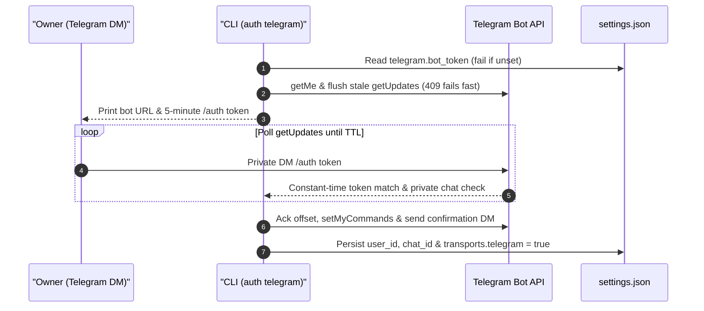
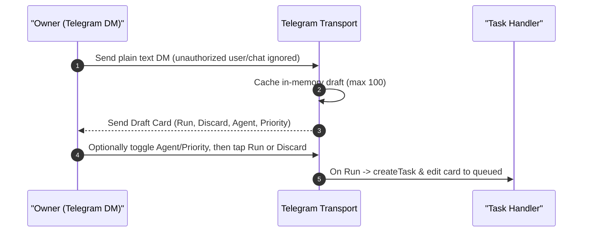
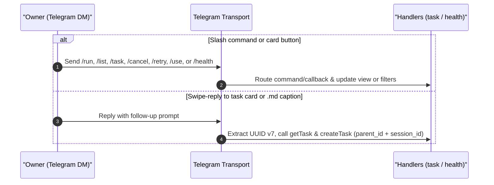
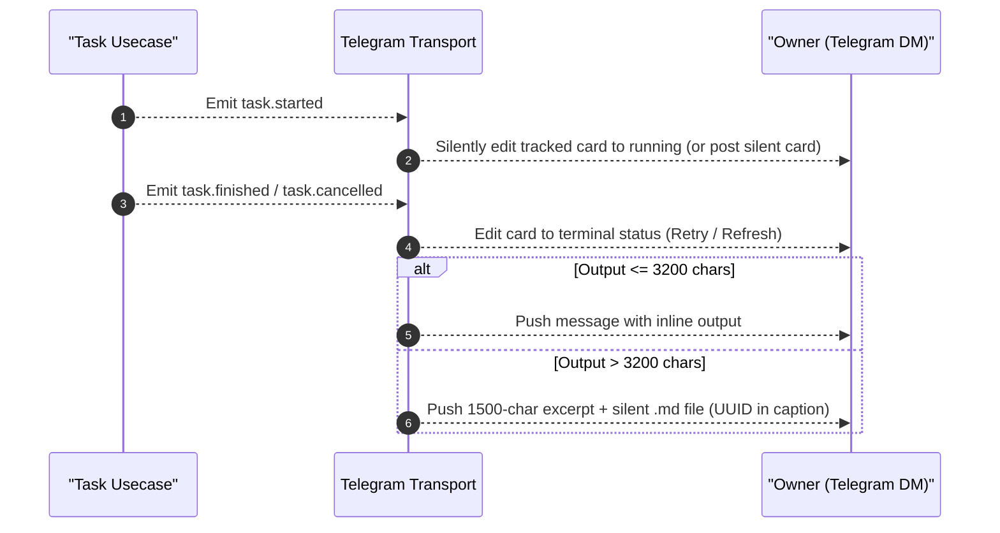

# Sequence: Telegram Pairing, Control & Notifications

Covers one-time pairing (`task-aside auth telegram`), single-owner long polling, Draft Cards, slash commands, callbacks, Swipe-Reply resume, and serialized live notifications.

## 1. One-Time Pairing (`auth telegram`)

## 2. Draft Card Intake (Plain Text)

## 3. Commands & Swipe-Reply

## 4. Live Notifications & Delivery

## Telegram Rules & Boundaries

| Aspect | Behavior |
| --- | --- |
| **Pairing & auth** | Single-owner private DM bound to `user_id` + `chat_id`; non-matching updates ignored; `bot_token` redacted in logs/errors |
| **Slash commands** | `/run`, `/list [status]`, `/task <id>`, `/cancel <id>`, `/retry <id>`, `/use`, `/health`, `/help` (and `/start`) |
| **Inline callbacks** | Draft (`Run`, `Discard`, `Agent`, `Priority`), Defaults (`/use`), List filters, Task (`Cancel`/`Retry`, `Refresh`) |
| **Result delivery** | Per-task notifications serialize in memory; short output renders inline, long output sends excerpt + `.md` attachment |
| **Zero core state** | Drafts (max 100), card map (max 500), defaults, per-task queues, and poll offset live in memory only |
