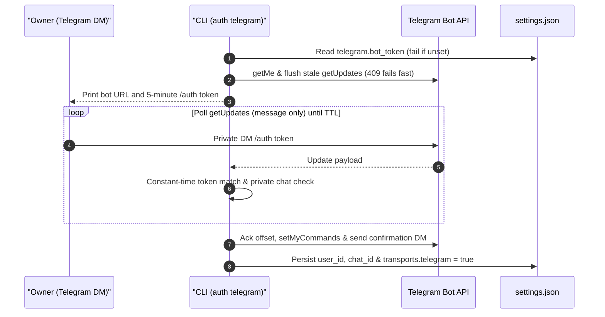
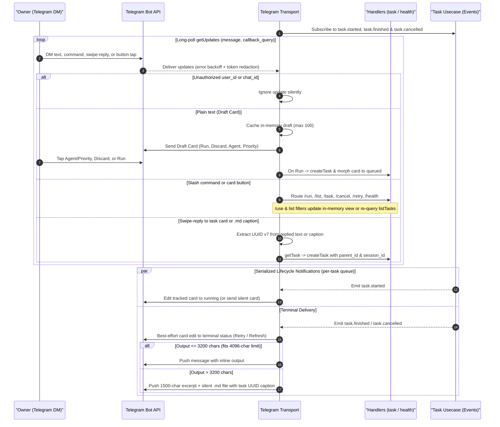

# Sequence: Telegram Pairing, Control & Notifications

Covers one-time interactive pairing (`task-aside auth telegram`), single-owner long polling, Draft Cards, slash commands, inline callbacks, Swipe-Reply resume, and serialized live notifications.

## Pairing Flow

## Runtime Intake, Control & Delivery

## Telegram Rules & Boundaries

| Aspect | Behavior |
| --- | --- |
| **Pairing & auth** | Single-owner private DM bound to both `user_id` and `chat_id`; non-matching updates ignored; `bot_token` redacted in logs/errors |
| **Slash commands** | `/run`, `/list [status]`, `/task <id>`, `/cancel <id>`, `/retry <id>`, `/use`, `/health`, `/help` (and `/start`) |
| **Inline callbacks** | Draft (`Run`, `Discard`, `Agent`, `Priority`), Defaults (`/use`), List filters (`All`/`Queued`/`Running`/`Completed`/`Failed`), Task (`Cancel`/`Retry`, `Refresh`) |
| **Result delivery** | Short output renders inline; long output splits into push excerpt plus silent `.md` attachment carrying task UUID in caption |
| **Zero core state** | Drafts (max 100), task-card map (max 500), active defaults, per-task queues, and poll offset stay in memory; `public.tasks` stores no Telegram state |
