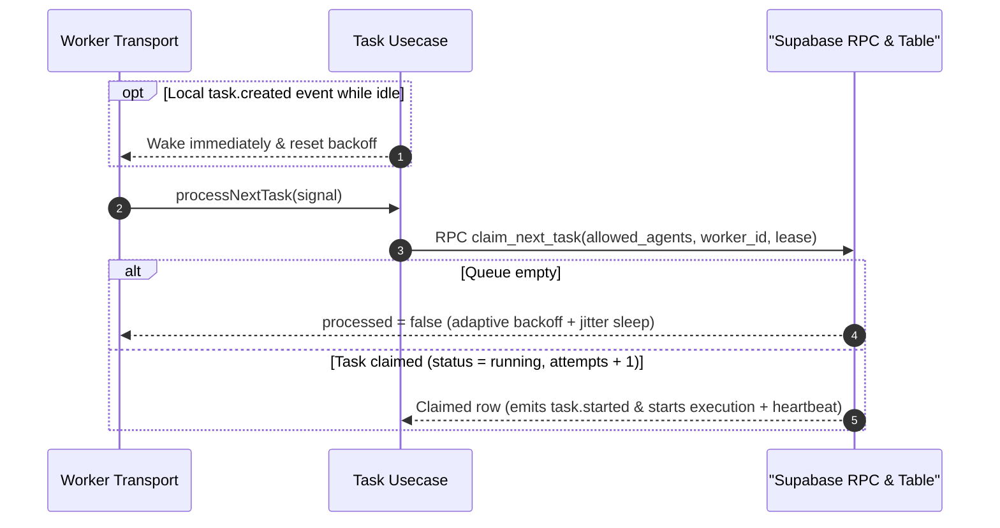
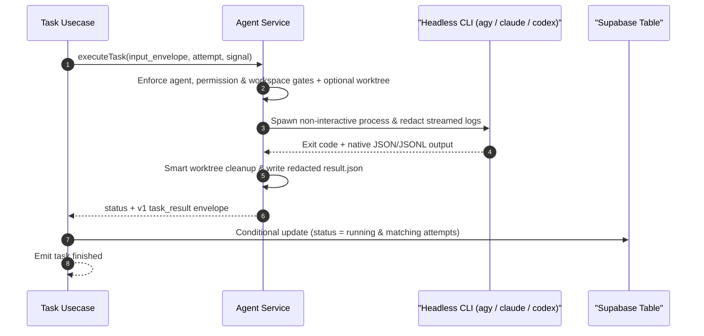
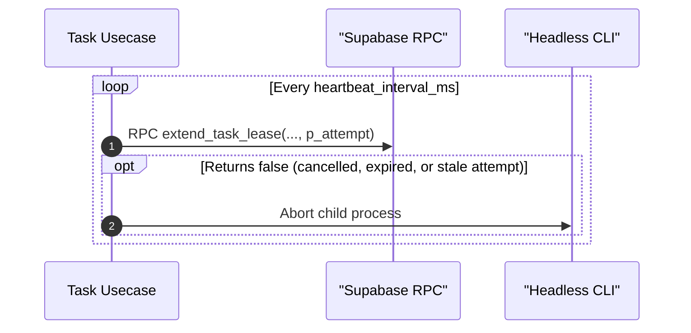

# Sequence: Worker Execution & Notifications

Covers adaptive polling, atomic task claiming in Supabase, attempt-fenced lease heartbeats, opt-in git worktree isolation, secret-redacted CLI runs, and completion updates.

## 1. Adaptive Poll & Claim

## 2. Agent Execution & Completion

## 3. Fenced Lease Heartbeat (Parallel to Execution)

## Execution & Notification Rules

| Aspect | Behavior |
| --- | --- |
| **Adaptive polling** | Idle intervals step from `poll_interval_ms` to `poll_max_interval_ms` (`±15%` jitter); task completion or `task.created` resets immediately |
| **Scheduling & fencing** | `claim_next_task` uses `FOR UPDATE SKIP LOCKED` by `priority` then `created_at`; `extend_task_lease` and `finishTask` fence on `attempts` |
| **Policy & worktree gates** | Rejects disallowed agents, permission ceiling breaches, or `cwd` outside `allowed_workspaces`; opt-in `worktree` isolates runs in `runs/<id>/worktree` |
| **Secret redaction** | `redactSecrets` scrubs credentials and API/Bearer/bot-token patterns from daemon logs, `agent.log`, raw outputs, errors, and `result_envelope` |
| **Notifications** | `task.started` and `task.finished` drive Telegram card updates and result delivery (see [seq-telegram.md](./seq-telegram.md)) |
