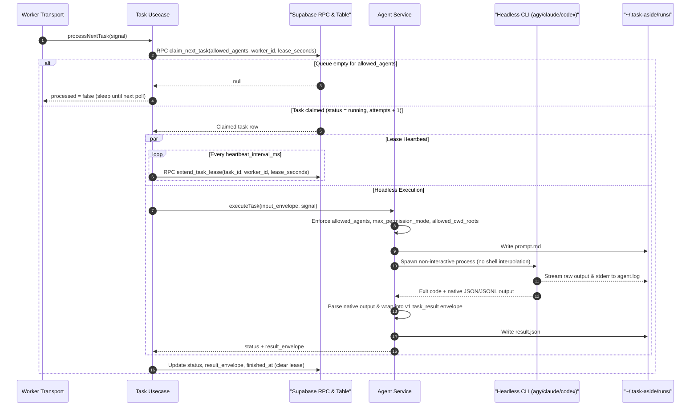

# Sequence: Worker Execution

Covers the sequential background loop from claiming a queued task in Supabase through running a headless CLI agent and persisting the standardized result.

## Claim, Heartbeat & Execution Flow

## Execution & Output Rules

| Aspect | Behavior |
| --- | --- |
| **Scheduling order** | `claim_next_task` uses `FOR UPDATE SKIP LOCKED`, filtering by `allowed_agents` and ordering by `priority` (`P0` first) then `created_at` |
| **Policy gates** | Pre-spawn checks reject disallowed agents, `permission_mode` above `max_permission_mode`, missing `cwd`, or `cwd` outside `allowed_cwd_roots` |
| **Single-layer wrapping** | Agents run without forced JSON schemas so they produce natural Markdown; `Agent Service` normalizes native CLI output into `task_result` |
| **Local run artifacts** | Each attempt writes `prompt.md`, raw CLI output (`raw-output.json` or `events.jsonl`), `agent.log`, and `result.json` under `~/.task-aside/runs/` |
