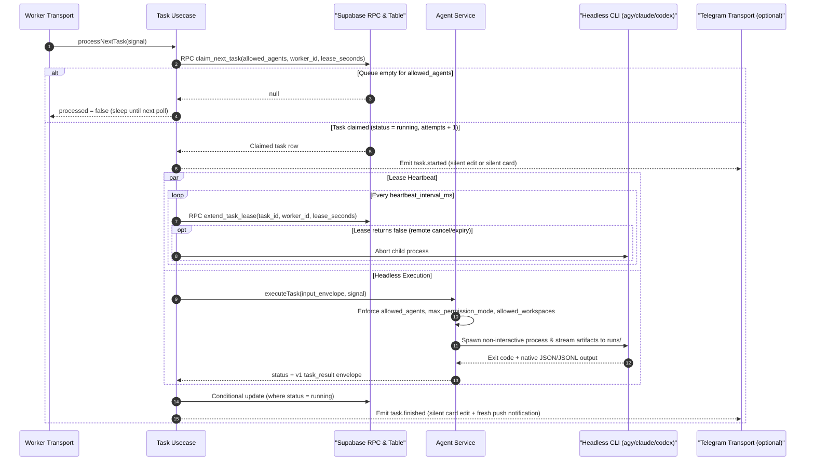

# Sequence: Worker Execution & Notifications

Covers the sequential background loop from claiming a queued task in Supabase through headless CLI execution, lifecycle event emission, and Telegram notifications.

## Claim, Heartbeat & Execution Flow

## Execution & Notification Rules

| Aspect | Behavior |
| --- | --- |
| **Scheduling order** | `claim_next_task` uses `FOR UPDATE SKIP LOCKED`, filtering by `allowed_agents` and ordering by `priority` (`P0` first) then `created_at` |
| **Policy gates** | Pre-spawn checks reject disallowed agents, `permission_mode` above `max_permission_mode`, missing `cwd`, or `cwd` outside `allowed_workspaces` |
| **Remote cancellation** | `finishTask` guards `status = running`, and heartbeat loss aborts the running child so `cancelled` is never overwritten with `interrupted` |
| **Telegram delivery** | Short Markdown renders inline; outputs above ~3200 chars send an excerpt plus an attached `.md` document containing the task UUID |
